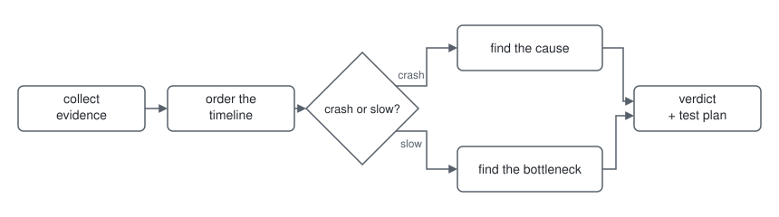

<div align="center">

# Minecraft Debugging Skill

**Drop this skill into your local agent to debug large Minecraft modpacks.**


</div>

A large modpack spreads its evidence across logs, crash reports, and
profiler output. This skill gives your agent a fixed workflow for reading
it: wait for the instance path, inventory the evidence with session
binding, reconstruct the timeline, branch by symptom, verify every
setting/runtime/version claim — and report bottom line plus the one next
test that settles the uncertainty.
Works with Forge, NeoForge, Fabric, and Quilt, in any launcher layout.

<picture>
  <source media="(prefers-color-scheme: dark)" srcset="assets/workflow-dark.svg" />
  
</picture>

<details>
<summary><b>How it works</b></summary>

- Wait for the instance path — no scanning for modpacks.
- Inventory the evidence with timestamps and session binding — then pin
  the run by correlation, not filename.
- Order the timeline and attribute the failure to the first causal break,
  not the final log entry.
- Branch by symptom: crash and compatibility, performance and the JVM, then
  verify every setting/runtime/version claim before recommending it.
- Report bottom line, evidence, what is not proven, ranked reversible
  steps, and the one next capture that settles the uncertainty.
</details>

<details>
<summary><b>Install</b></summary>

```bash
git clone https://github.com/Malte-Dzierzon/minecraft-debugging-skill.git
cd minecraft-debugging-skill
./install.sh
```

Symlinks the payload (`SKILL.md` + `references/`) into
`~/.omp/agent/skills/minecraft-debugging-skill/`, so a later `git pull`
updates the installed skill. Other agents:

```bash
./install.sh --agent claude   # ~/.claude/skills/
./install.sh --agent codex    # ~/.codex/skills/
./install.sh --all            # every agent dir that already exists
```

`--copy` copies instead of linking, `--dry-run` previews, `--uninstall`
removes. Only the payload is installed — repo docs stay here. Reload the
agent afterwards.

</details>

<details>
<summary><b>Repository layout</b></summary>

- `SKILL.md` — the skill: instance gate, phased workflow, report shape.
- `references/1-artifacts.md` — inventory-first evidence gathering.
- `references/2-crash.md` — crash signatures, log triage, native, memory.
- `references/3-performance.md` — Spark semantics, Loading Profiler, GC.
- `references/4-verification.md` — setting ownership, LOD/shader/Java rules.
- `tests/EVALUATIONS.md` — maintainer acceptance scenarios.
- `install.sh` — payload installer for local agents.

</details>
