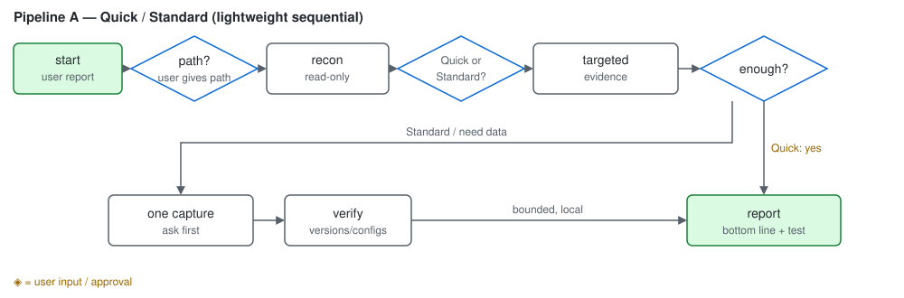
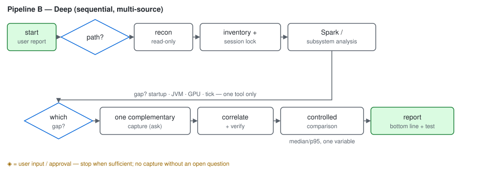
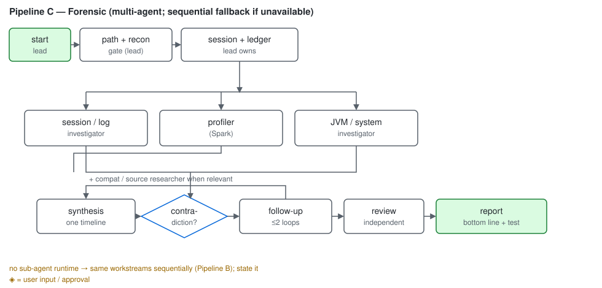

<div align="center">

# Minecraft Debugging Skill

**Evidence-based debugging for Minecraft Java modpacks.**


</div>

Give your agent an instance path and describe the problem. It checks the
available logs and profiler data, then chooses how deeply to investigate.

Works with Forge, NeoForge, Fabric, and Quilt.

<details>
<summary><b>Quick / Standard</b> — the focused, single-session workflow</summary>

<picture>
  <source media="(prefers-color-scheme: dark)" srcset="assets/workflow-simple-dark.svg" />
  
</picture>

Quick uses existing evidence where possible. Standard can add one focused capture.

</details>

<details>
<summary><b>Deep</b> — the more detailed investigation with additional measurements</summary>

<picture>
  <source media="(prefers-color-scheme: dark)" srcset="assets/workflow-deep-dark.svg" />
  
</picture>

Deep combines Minecraft-aware profiling with one matching JVM or system check, then compares measurements under the same conditions.

</details>

<details>
<summary><b>Forensic</b> — the investigation that can use multiple agents and an independent review</summary>

<picture>
  <source media="(prefers-color-scheme: dark)" srcset="assets/workflow-forensic-dark.svg" />
  
</picture>

Forensic splits the work across focused investigators, then a second agent reviews the findings. Without sub-agent support it runs the same steps sequentially.

</details>

<details>
<summary><b>How it works</b></summary>

- The agent waits for the instance path; it never searches your computer for modpacks.
- It checks which Minecraft version, loader, mods, profiler mods, and diagnostic files are present.
- It asks how deeply to investigate, then follows the matching workflow.
- Findings are tied to evidence. Changes and invasive captures require approval.

</details>

<details>
<summary><b>Use</b></summary>

```text
Use the minecraft-debugging-skill skill.
Instance: /path/to/Prism/instances/MyPack/.minecraft
Problem: The client stutters when joining a world.
```

</details>

<details>
<summary><b>Profiler tools</b></summary>

- Spark: Minecraft runtime profiling (client or server).
- Loading Profiler: startup timing only, in a disposable copy — never on a valued world.
- VisualVM / JFR: JVM data when memory or garbage collection may be involved.
- async-profiler, perf, Hotspot: only for specific questions the above cannot answer.

</details>

<details>
<summary><b>Safety and privacy</b></summary>

Read-only by default. Invasive captures, instance changes, and uploads
need explicit approval. Logs can leak usernames, paths, server addresses,
and tokens — excerpts stay local and redacted.

</details>

<details>
<summary><b>Install</b></summary>

```bash
git clone https://github.com/Malte-Dzierzon/minecraft-debugging-skill.git
cd minecraft-debugging-skill
./install.sh
```

Symlinks the payload (`SKILL.md` + `references/`) into
`~/.omp/agent/skills/minecraft-debugging-skill/`, so a later `git pull`
updates the installed skill. Other agents:

```bash
./install.sh --agent claude   # ~/.claude/skills/
./install.sh --agent codex    # ~/.codex/skills/
./install.sh --all            # every agent dir that already exists
```

`--copy` copies instead of linking, `--dry-run` previews, `--uninstall`
removes. Only the payload is installed — repo docs stay here. Reload the
agent afterwards.

</details>

<details>
<summary><b>Repository layout</b></summary>

- `SKILL.md` — the skill: instance gate, workflow, rules, report shape.
- `references/1-artifacts.md` — finding artifacts, session binding, privacy.
- `references/2-crash.md` — crash signatures, log triage, compatibility.
- `references/3-performance.md` — Spark, Loading Profiler, GC, JVM tools.
- `references/4-verification.md` — setting ownership, version checks, sources.
- `tests/EVALUATIONS.md` — maintainer acceptance scenarios.
- `install.sh` — payload installer for local agents.

</details>
